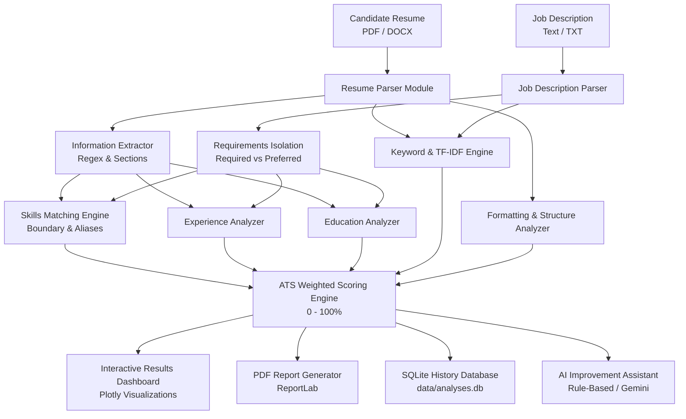

# 🎯 AI Resume Analyzer & ATS Score Checker

[](https://www.python.org/)
[](https://streamlit.io/)
[](https://opensource.org/licenses/MIT)
[](https://github.com/psf/black)

A production-style, privacy-first **AI Resume Analyzer & ATS Compatibility Score Checker** built with Streamlit, advanced Natural Language Processing (NLP), and ReportLab.

Designed for college final-year capstone submissions, portfolio showcases, and real-world job seekers who want transparent algorithmic insights into recruitment automation without sacrificing data privacy or relying on mandatory paid API keys.

---

## 📑 Table of Contents
1. [Project Overview](#-project-overview)
2. [Key Features](#-key-features)
3. [System Architecture](#-system-architecture)
4. [Technology Stack](#-technology-stack)
5. [Folder Structure](#-folder-structure)
6. [Installation & Setup](#-installation--setup)
7. [Running the Application](#-running-the-application)
8. [Running Unit Tests](#-running-unit-tests)
9. [ATS Scoring Methodology](#-ats-scoring-methodology)
10. [AI Assistant & API Configuration](#-ai-assistant--api-configuration)
11. [Privacy & Security Commitments](#-privacy--security-commitments)
12. [Known Limitations](#-known-limitations)
13. [Deployment Instructions](#-deployment-instructions)
14. [License](#-license)

---

## 🌟 Project Overview

Applicant Tracking Systems (ATS) are software applications used by modern companies to manage, parse, rank, and filter job applicants. However, candidates often suffer from "ATS Black Holes" with zero transparency into why their resumes failed automated screening.

This project delivers:
- **Instant multi-factor ATS evaluation** (0–100%) with complete breakdown across skills, experience, education, keywords, and structural formatting.
- **Deep skill gap analysis** separating *explicitly required* skills from *preferred/bonus* qualifications.
- **Actionable resume optimization suggestions** with quantified achievement formulas and action verbs.
- **Downloadable executive PDF reports** formatted with ReportLab.
- **Privacy-first offline execution** that works 100% locally without external API dependencies.

> ⚠️ **Important Disclaimer:** The ATS compatibility score is an estimated algorithmic metric calculated from NLP and keyword matching rules. It is not an official score from Workday, Taleo, Greenhouse, Lever, or any specific employer's proprietary ATS.

---

## ✨ Key Features

- **Document Parsing Engine:**
  - Fast vector text extraction from PDF (`PyMuPDF`) and DOCX (`python-docx`).
  - Scanned image PDF detection with friendly OCR requirement notices.
  - Body paragraph and table cell text extraction.
- **Entity & Information Extraction:**
  - Extracts contact details (Name, Email, Phone, LinkedIn, GitHub, Portfolio).
  - Isolates sections (Summary, Skills, Experience, Education, Projects, Certifications).
- **Intelligent Skills Taxonomy:**
  - 100+ categorized skills across Programming, Frontend, Backend, Databases, AI/ML, Cloud/DevOps, and Data Analytics.
  - Substring-safe word boundary matching (e.g., `C` doesn't match `CSS`, `Go` doesn't match `Good`).
  - Canonical alias mapping (`JS` ➔ `JavaScript`, `k8s` ➔ `Kubernetes`, `Postgres` ➔ `PostgreSQL`).
- **Transparent Weighted Scoring:**
  - Formula: `Skills (40%) + Experience (20%) + Education (15%) + Keywords (15%) + Formatting (10%) = 100%`.
  - Configurable weights via sidebar slider.
  - Documented missing-data policy (proportional re-normalization).
- **Interactive Visualizations:**
  - Plotly circular score gauge.
  - 5-Pillar radar balance chart against a 75% target benchmark.
  - Categorized skill breakdown donut charts.
- **Resume Improvement Assistant:**
  - Tailored summary rewriter.
  - High-impact bullet point enhancer with action verbs and metric placeholders.
  - STAR project structuring guidelines (Situation, Task, Action, Result).
  - Optional Google Gemini or Hugging Face integration with offline rule-based fallback.
- **Publication-Quality PDF Reports:**
  - Professional ReportLab PDF generation with score cards, tables, dynamic page numbers, and custom canvas.
- **Local Analysis History:**
  - SQLite database tracking scores, target roles, and dates.
  - Parameterized queries and one-click record deletion.

---

## 🏛️ System Architecture



---

## 🛠️ Technology Stack

| Layer | Technologies |
|---|---|
| **Frontend UI** | Streamlit 1.35+, Custom CSS Design System (Linear/Notion aesthetic) |
| **Visualizations** | Plotly (Gauge, Radar, Horizontal Bar, Donut) |
| **PDF Extraction** | PyMuPDF (`fitz`), `pypdf` |
| **DOCX Extraction** | `python-docx` |
| **NLP & Similarity** | `scikit-learn` (TF-IDF vectorizer, cosine similarity), Regular Expressions |
| **Report Generation** | `ReportLab` (Platypus, NumberedCanvas) |
| **Database** | SQLite3 (Parameterized queries, JSON storage) |
| **AI Assistants** | Optional Google Gemini REST API, Hugging Face API, Offline Rule Engine |
| **Testing** | `pytest` |

---

## 📁 Folder Structure

```text
resume-analyzer/
│
├── app.py                      # Main Streamlit application entry point
├── requirements.txt            # Project dependencies
├── README.md                   # Complete documentation
├── .env.example                # Example environment variable template
├── .gitignore                  # Git ignore rules (protects data, venv, secrets)
│
├── config/
│   ├── __init__.py
│   ├── settings.py             # Configuration constants, weights, and limits
│   └── skills_dictionary.py    # Categorized skills taxonomy and compiled regex
│
├── modules/
│   ├── __init__.py
│   ├── resume_parser.py        # PDF & DOCX extraction and scanned detection
│   ├── information_extractor.py# Section and contact entity extraction
│   ├── job_description_parser.py# JD parsing (Required vs Preferred isolation)
│   ├── skills_matcher.py       # Taxonomy matching & gap calculation
│   ├── experience_analyzer.py  # Tenure extraction & comparison
│   ├── education_analyzer.py   # Degree tier evaluation
│   ├── keyword_analyzer.py     # TF-IDF & domain keyword density
│   ├── formatting_analyzer.py  # Structural readability & ATS safety checks
│   ├── ats_scorer.py           # Weighted ATS score engine & policy handler
│   ├── ai_assistant.py         # Gemini / Hugging Face / Rule-based engine
│   ├── report_generator.py     # ReportLab publication-quality PDF generator
│   └── database.py             # SQLite CRUD operations and metrics
│
├── components/
│   ├── __init__.py
│   ├── sidebar.py              # Sidebar navigation and preferences
│   ├── dashboard.py            # Home page with metrics and activity
│   ├── upload_form.py          # Upload, preview, and analysis trigger
│   ├── results_view.py         # Results dashboard with charts & download
│   ├── improvement_guide.py    # Actionable resume optimization guide
│   ├── history_view.py         # Stored history management & search
│   ├── about_view.py           # Documentation, stack, and ATS myths
│   └── charts.py               # Plotly gauge, radar, bar, and donut charts
│
├── styles/
│   └── main.css                # Custom Linear & Notion inspired design system
│
├── tests/
│   ├── conftest.py             # Pytest discovery configuration
│   ├── test_ats_scorer.py      # Core ATS scoring test cases (Cases 1-4)
│   ├── test_skills_matcher.py  # Skills normalization & boundary tests
│   ├── test_resume_parser.py   # PDF, DOCX, empty & corrupt file tests
│   └── test_database.py        # SQLite operations and PDF export tests
│
├── data/
│   └── .gitkeep                # SQLite database location (analyses.db)
│
└── reports/
    └── .gitkeep                # Generated PDF reports storage
```

---

## 🚀 Installation & Setup

### Prerequisites
- Python **3.10** or **3.11** installed.
- Git (optional, for version control).

### Step 1: Clone or Navigate to the Project Directory

```bash
cd "c:\Users\shriv\Desktop\resume analyser"
```

### Step 2: Create a Virtual Environment

#### Windows (PowerShell):
```powershell
python -m venv .venv
.\.venv\Scripts\Activate.ps1
```

#### macOS / Linux:
```bash
python3 -m venv .venv
source .venv/bin/activate
```

### Step 3: Install Required Dependencies

```bash
pip install --upgrade pip
pip install -r requirements.txt
```

### Step 4: Configure Environment Variables (Optional)

Copy `.env.example` to `.env`:

#### Windows:
```powershell
Copy-Item .env.example .env
```

#### macOS / Linux:
```bash
cp .env.example .env
```

*(Optional)* Open `.env` and add your Google Gemini or Hugging Face API key. The application works completely offline without any API keys.

---

## 💻 Running the Application

Activate your virtual environment and start the Streamlit development server:

```powershell
streamlit run app.py
```

The application will launch in your browser automatically at:
👉 **`http://localhost:8501`**

---

## 🧪 Running Unit Tests

Run the full automated test suite using `pytest`:

```powershell
python -m pytest -v tests/
```

### Verified Test Cases
1. **Case 1 (All 100):** All component scores are 100 ➔ Overall score: `100.0`.
2. **Case 2 (All 0):** All component scores are 0 ➔ Overall score: `0.0`.
3. **Case 3 (Standard Mix):**
   - Skills = 80 (40%) = 32.0
   - Experience = 70 (20%) = 14.0
   - Education = 100 (15%) = 15.0
   - Keywords = 60 (15%) = 9.0
   - Formatting = 90 (10%) = 9.0
   - **Expected Overall Score:** `78.0`.
4. **Case 4 (Missing Components Policy):** Re-normalizes available weights when experience or education are not specified, with transparent disclosure.
5. **Boundary Tests:** Strict clamping between `0.0` and `100.0`.
6. **Parser Tests:** PyMuPDF, python-docx, corrupted files, and 0-byte detection.
7. **Database Tests:** SQLite CRUD, record deletion, and ReportLab PDF compilation.

---

## 📊 ATS Scoring Methodology

The overall score is computed from 5 independent pillars:

$$\text{Final Score} = (S \times 0.40) + (E \times 0.20) + (Ed \times 0.15) + (K \times 0.15) + (F \times 0.10)$$

Where:
- **$S$ (Skills Match - 40%):** Weighted comparison of candidate skills against required (75% weight) and preferred (25% weight) technical proficiencies.
- **$E$ (Experience - 20%):** Chronological tenure and explicit years of experience compared to target minimum years.
- **$Ed$ (Education - 15%):** Degree hierarchy matching (Bachelor's, Master's, PhD). Never penalizes for unrequested degrees.
- **$K$ (Keywords - 15%):** Domain term coverage and TF-IDF cosine alignment (excluding common stop words).
- **$F$ (Formatting - 10%):** Structural readability, contact completeness, length safety (350–1200 words), and action verb usage.

### Missing Data Policy
If a component cannot be evaluated (e.g., job description has no experience or education requirements), its weight is excluded, and the remaining weights are proportionally re-normalized so they sum to 100%.

---

## 🤖 AI Assistant & API Configuration

The application includes an optional AI Career Coach:
1. **Offline Rule-Based Engine (Default):** Zero cost, instant, 100% deterministic, and never shares your data with third parties.
2. **Google Gemini Integration:** Enter your Gemini API key in `.env` or in the sidebar to generate personalized dynamic summaries and bullet point suggestions.
3. **Hugging Face Inference:** Supports open-source LLMs via Hugging Face router.

### Rules of AI Integrity
- The system **never** invents employers, degrees, certifications, or performance metrics.
- Suggested bullet points contain bracketed placeholders (e.g., `[Insert % improvement]`) for candidate verification.

---

## 🔒 Privacy & Security Commitments

- **In-Memory Processing:** Uploaded resumes are read into memory streams and discarded when the session ends.
- **No Unsolicited File Storage:** Raw resumes are never written to disk.
- **Minimal Metadata Storage:** Only high-level metrics (score, target job title, skill count) are saved in local SQLite `data/analyses.db` if history is enabled.
- **History Purging:** You can delete individual records or clear your entire history with one click.
- **No Secrets in Frontend:** API keys are stored in session state or `.env` and never leaked into HTML DOM.

---

## ⚠️ Known Limitations

1. **Scanned / Image-Only PDFs:** PDFs that consist purely of flat raster images without digital selectable text require an OCR engine (e.g. Tesseract). The app detects these and warns the user.
2. **Proprietary ATS Variations:** Every employer's ATS configuration is unique. The score is an estimated compatibility guideline, not a guarantee of human recruiter review.
3. **Ephemeral Cloud Storage:** On Streamlit Community Cloud, local SQLite database files reset when the server restarts unless connected to persistent cloud storage.

---

## ☁️ Deployment Instructions

### Deploying to Streamlit Community Cloud
1. Push your repository to GitHub.
2. Visit [share.streamlit.io](https://share.streamlit.io/) and log in.
3. Click **"New App"** and select your repository, branch (`main`), and main file path (`app.py`).
4. In **Advanced Settings**, add any optional secrets (e.g. `GEMINI_API_KEY = "your-key"`).
5. Click **"Deploy"**!

---

## 📜 License

This project is licensed under the [MIT License](LICENSE).
Created with ❤️ for portfolio and final-year engineering project demonstration.
